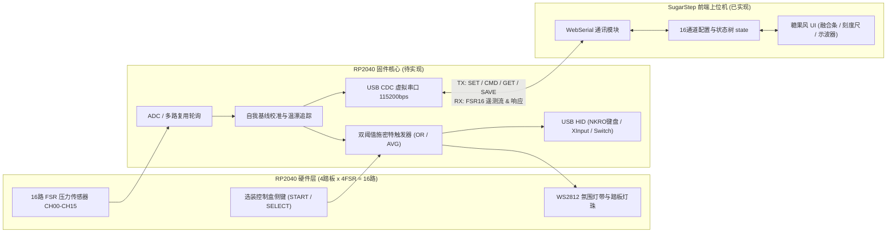
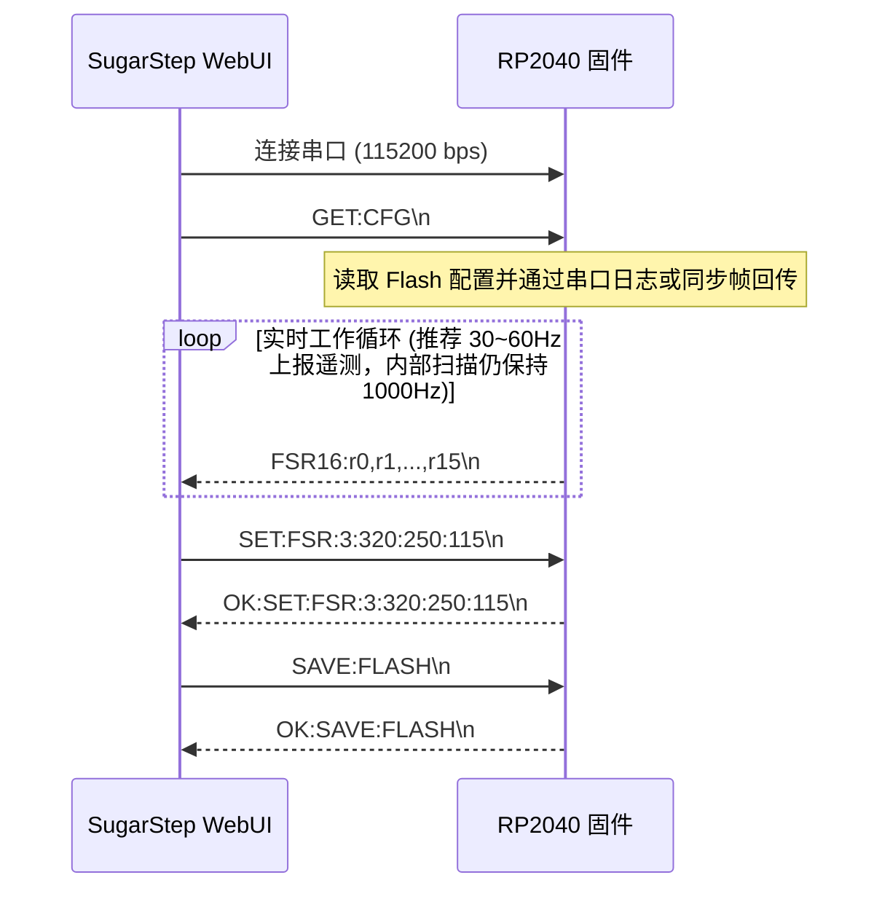

# SugarStep · RP2040 DDR 踏板控制器设计文档与扩展开发规范

> 本文档面向两部分工作：**（1）RP2040 主控固件开发与协议对接**；**（2）前端 UI 风格、交互组件及后续新增功能的统一开发规范**。  
> 仓库：[kirisamesusi/step-lattice](https://github.com/kirisamesusi/step-lattice)（上位机前端与固件开发规范）

---

## 0. 项目概览与文件结构

SugarStep 是一款面向 DIY RP2040 DDR 跳舞机踏板控制器的可视化配置台，采用零构建依赖的纯原生 HTML / CSS / ES6+ 实现，通过浏览器 WebSerial API（`115200 bps`）与 RP2040 硬件直接通信。

| 文件 | 核心职责 | 说明 |
| :--- | :--- | :--- |
| [index.html](./index.html) | 页面骨架与视图结构 | 含顶栏、十字踏板舞台、4 个功能分区、二次确认/JSON 弹窗及可整段剥离的 `devSimCard` 区块 |
| [styles.css](./styles.css) | 糖果风视觉系统与组件样式 | 含柔和三色渐变背景、果冻立体卡片、100% 等宽融合滑动条、刻度尺及 `.sim-only` 控制规则 |
| [app.js](./app.js) | 状态管理、交互逻辑与串口协议 | 含 16 路 FSR 状态模型、10 单位刻度吸附、3 位数校验、60fps 波形绘制、WebSerial 与 `localStorage` |
| [DESIGN_SPEC.md](./DESIGN_SPEC.md) | 系统设计文档与开发规范 | 本文档（与代码库同步维护） |

### 系统总体架构



---

# 第一部分：RP2040 固件开发对接规范

编写 RP2040 固件时，所有传感器编号、压感换算、基线追踪与触发状态机应严格与本节保持一致，以确保网页调参手感与主控实际判键完全同步。

---

## 1. 硬件通道拓扑与传感器映射（`CH00 ~ CH15`）

控制器固定包含 `4` 块主踏板，每块踏板按 `n -> s -> w -> e`（上/下/左/右边缘）布置 `4` 颗独立 FSR 传感器，共 `16` 路通道，索引顺序严格如下：

| 踏板键名 | 踏板名称 | 固件踏板序号 `padIdx` | 内侧增敏方向 `innerDir` | 通道映射（`CH` 编号 = `padIdx * 4 + dirIdx`） |
| :--- | :--- | :---: | :---: | :--- |
| `left` | 左踏板（←） | `0` | `e`（靠中心右侧边） | `CH00`: `n`（上），`CH01`: `s`（下），`CH02`: `w`（左），`CH03`: `e`（右·内侧） |
| `down` | 下踏板（↓） | `1` | `n`（靠中心上侧边） | `CH04`: `n`（上·内侧），`CH05`: `s`（下），`CH06`: `w`（左），`CH07`: `e`（右） |
| `up` | 上踏板（↑） | `2` | `s`（靠中心下侧边） | `CH08`: `n`（上），`CH09`: `s`（下·内侧），`CH10`: `w`（左），`CH11`: `e`（右） |
| `right` | 右踏板（→） | `3` | `w`（靠中心左侧边） | `CH12`: `n`（上），`CH13`: `s`（下），`CH14`: `w`（左·内侧），`CH15`: `e`（右） |

> **选装外接按键说明**：`START`（确认键）与 `SELECT`（返回键）为控制盒侧面选装实体微动开关，不占用 16 路 FSR 通道，仅作普通 GPIO 消抖扫描后映射到 USB HID。

---

## 2. 压感换算、校准与触发算法规范

### 2.1 数值坐标系与量程约定

| 参数 | 量程范围 | 数据类型 | 说明 |
| :--- | :---: | :---: | :--- |
| 原始 ADC 读数 `raw[i]` | `0 ~ 1023` | `uint16_t` | 统一按 10-bit 满量程归一化（RP2040 原生 12-bit ADC 需右移 2 位：`raw12 >> 2`） |
| 空载基线 `baseline[i]` | `0 ~ 500` | `float` / 整数 | 空载静置偏置；手动校准时会限制在 `[0, 500]` 内防止误将脚踩重压锁成基线 |
| 信号增益 `gain[i]` | `50 ~ 150`（%） | `uint8_t` | 传感器独立放大倍率，默认 `100`；内侧增敏开启时内侧 4 颗默认 `115` |
| 净压力值 `net[i]` | `0 ~ 999` | `uint16_t` | 与前端融合条、3 位数输入框、刻度尺统一对齐的标准 3 位数标尺 |
| 触发阈值 `trigger[i]` | `1 ~ 999` | `uint16_t` | 踩下判定阈值（默认 `360`），拖动滑块步进为 `10`，精确输入支持任意 3 位整数 |
| 释放回差 `release[i]` | `0 ~ maxRel` | `uint16_t` | 抬脚释放阈值（默认 `280`），约束规则见下方 2.4 节 |

### 2.2 净压力换算公式

对每颗传感器 $i \in [0, 15]$，实时净压力 $\text{net}_i$ 计算如下：

$$
\text{net}_i = \operatorname{clamp}\!\left(\operatorname{round}\!\left((\text{raw}_i - \text{baseline}_i) \times \frac{\text{gain}_i}{100}\right),\ 0,\ 999\right)
$$

### 2.3 自我基线校准算法（Self-Baseline Calibration）

固件应实现以下三种协同校准机制：

1. **通电自动归零（`bootAutoCal = true`）**：上电等待电源稳定（建议 100ms~200ms），对 16 路通道连续采样取均值，限幅到 `[0, 500]` 后写入各通道 `baseline[i]`。
2. **指令触发瞬时校准（`CMD:CAL_BASE:*`）**：收到全部、单踏板或单通道校准命令后，采样当前空载瞬时值或短窗口均值更新对应 `baseline[i]`，并限幅 `[0, 500]`。
3. **动态温漂追踪（`autoDriftTrack = true`）**：当传感器处于**未触发状态**（`!active[i]`），且 $|\text{raw}_i - \text{baseline}_i| < 25$ 时，按慢速一阶滤波缓慢吸收温漂或踏板海绵形变回弹：

$$
\text{baseline}_i \leftarrow \text{baseline}_i + 0.015 \times (\text{raw}_i - \text{baseline}_i)
$$

> **注意**：当前端以约 60Hz 估算时系数为 `0.015`；若 RP2040 固件采样周期更高（如 `1000Hz`），应将更新步长按采样率缩放或固定每 `16ms` 执行一次漂移追踪，避免脚轻放时基线被瞬间吸走。

### 2.4 双阈值施密特触发与踏板合成

1. **回差约束规则**：始终保证释放线严格低于触发线，防止零点附近高频连击抖动：

$$
\text{maxRel}_i = \begin{cases} \text{trigger}_i - 20, & \text{trigger}_i > 20 \\ \max(0,\ \text{trigger}_i - 1), & \text{trigger}_i \le 20 \end{cases}
$$

2. **单传感器状态转移**：
   - 未触发态（`active == false`）：当 `net >= trigger`（再叠加以 `debounceMs` 计时的时间去抖窗口，默认 `2.0 ms`）时，置为 `active = true`；
   - 已触发态（`active == true`）：当 `net <= release` 时，置为 `active = false`。
3. **踏板合成逻辑（`padLogic`）**：
   - **`OR` 模式（默认，任一传感器过线即触发）**：4 颗传感器中任意 1 颗 `active == true`，则该踏板判定按下；4 颗均 `false` 时释放。适合踩边缘/脚跟蹭键。
   - **`AVG` 模式（四颗平均值过线触发）**：计算 4 颗净压力均值 `avgNet`、平均触发线 `avgTrig` 与平均释放线 `avgRel`；未触发时 `avgNet >= avgTrig` 触发，已触发时 `avgNet <= avgRel` 释放（等价于 `avgNet > avgRel` 维持按下）。适合防止单角误重压或做整板平均力称重触发。
4. **内侧边增敏（`innerBoost`）**：
   - 开启时，自动将 `left.e (CH03)`、`down.n (CH04)`、`up.s (CH09)`、`right.w (CH14)` 的 `trigger` 设为其同板对侧边的 `0.85` 倍（`gain = 115`）；
   - 关闭时恢复同板四边一致的 `trigger / release` 且 `gain = 100`。

---

## 3. WebSerial 串口通讯协议规范

- **物理接口**：RP2040 USB CDC 虚拟串口
- **波特率与帧格式**：`115200 bps`，8N1，纯 ASCII 文本行，每条指令/遥测帧以 `\n`（兼容 `\r\n`）结尾。

### 3.1 握手与遥测时序



### 3.2 上行数据帧（RP2040 -> WebUI）

当前 [app.js](./app.js) 中 `handleIncomingSerial()` 的解析规范：

| 帧格式 | 说明 | 处理行为 |
| :--- | :--- | :--- |
| `FSR16:v0,v1,...,v15` | 16 路原始 ADC 值（英文逗号分隔，共 16 个 `[0, 1023]` 整数，顺序按 `CH00~CH15`） | 直接写入 `sensors[i].raw` 驱动实时压感条、踏板触发与 60fps 示波器，**不打印到串口日志黑框**（避免刷屏） |
| 其它任意文本行 | 如 `OK:...`、`ERR:...`、`CFG:...` 等应答或状态日志 | 自动加上时间戳与 `[RX]` 标签输出到串口调试终端 |

### 3.3 下行控制指令表（WebUI -> RP2040）

以下均为 [app.js](./app.js) 中**已实现并实际发送**的指令（每条均带 `\n`）：

| 指令格式 | 参数范围与含义 | 触发时机 |
| :--- | :--- | :--- |
| `GET:CFG` | 无参数 | 串口首次建立连接时 |
| `SET:PAD_TRIG:<padIdx>:<trig>` | `padIdx`: `0~3`（左/下/上/右），`trig`: `1~999` | 拖动/输入「整板统一调」阈值时（固件收到后需更新该板 4 颗传感器阈值，若当前开启了 `innerBoost` 需对内侧通道乘 `0.85` 并按 `0.78` 更新回差） |
| `SET:FSR:<ch>:<trig>:<rel>:<gain>` | `ch`: `0~15`，`trig`: `1~999`，`rel`: `0~trig-1`，`gain`: `50~150` | 拖动/输入「四边单独调」或「高级精调卡片」的触发、释放、增益滑块时 |
| `SET:PROFILE:<NAME>` | `COTTON` / `ARCADE` / `PUDDING` | 点击首页快捷灵敏度预设时 |
| `SET:INNER_BOOST:<0\|1>` | `1`=开启内侧增敏，`0`=恢复均衡 | 点击「内侧边增敏」按钮切换时 |
| `SET:DRIFT_TRACK:<0\|1>` | `1`=开启动态温漂追踪，`0`=关闭 | 切换高级页「动态追踪温漂」复选框时 |
| `SET:BOOT_CAL:<0\|1>` | `1`=开启通电自动归零，`0`=关闭 | 切换高级页「通电自动归零」复选框时 |
| `SET:PAD_LOGIC:<OR\|AVG>` | `OR`=任一过线触发，`AVG`=四颗均值过线 | 切换「踏板触发规则」下拉框时 |
| `SET:LED_MODE:<MODE>` | `RIPPLE` / `RAINBOW` / `BREATHE` / `AFTERGLOW` / `SOLID` | 点击灯效模式卡片时 |
| `SET:HID:<MODE>` | `KEYBOARD` / `XINPUT` / `SWITCH` | 切换 HID 输出模式时 |
| `SET:POLL:<HZ>` | `1000` / `500` / `250` | 切换 USB 回报率下拉框时 |
| `CMD:CAL_BASE:ALL` | 无参数 | 点击「校准全部 16 颗基线」时 |
| `CMD:CAL_BASE:PAD:<padIdx>` | `padIdx`: `0~3` | 点击「校准当前踏板 (4颗)」时 |
| `CMD:CAL_BASE:CH:<ch>` | `ch`: `0~15` | 点击单颗传感器卡片「校准基线」时 |
| `CMD:RESET_DEFAULTS` | 无参数 | 用户在二次确认弹窗点击「确定恢复」后 |
| `SAVE:FLASH` | 无参数 | 点击顶部「保存设置」按钮时（将当前内存配置写入 RP2040 Flash 掉电保存） |
| `CMD:BOOTSEL` | 无参数 | 点击高级页「进入刷机模式」时（RP2040 调用 `reset_usb_boot(0, 0)` 进入 UF2 烧录盘） |

### 3.4 后续固件扩展预留指令（当前前端暂未自动下发）

目前页面上的**自定义灯光颜色、亮度/底光/速度、去抖毫秒、按键键值表**会在点击「导入/导出 JSON」与保存本地配置中完整记录，但尚未对以下滑块绑定独立实时指令，后续完善硬件联动时可按同风格扩展：

| 建议扩展指令 | 对应 UI 控件 | 说明 |
| :--- | :--- | :--- |
| `SET:LED_COLOR:<padIdx>:<RRGGBB>` | `#color-left/down/up/right` 与配色方案按钮 | 下发 4 块踏板 RGB 十六进制颜色 |
| `SET:LED_PARAM:<bright>:<idle>:<speed>` | `#sliderLedBrightness` / `IdleBrightness` / `Speed` | 触发亮度（`10~100`）、待机底光（`0~80`）、速度（`10~100`） |
| `SET:DEBOUNCE:<ms_x10>` | `#sliderDebounce` | 去抖时间（`0.5 ~ 10.0 ms`，可传整数 `5~100` 表示 0.1ms 单位） |
| `SET:KEYMAP:<slot>:<hidCode>` | `.km-btn`（`left/down/up/right/start/select`） | 下发 USB HID Usage ID 或按键名 |

---

## 4. 出厂默认参数与 JSON 备份格式（`sugarstep-rp2040-v3`）

### 4.1 出厂默认值总表

- **灵敏度预设（`PROFILES`）**：
  - `cotton`（轻触）：触发 `210`，释放 `155`，增益 `105%`
  - `arcade`（标准，**默认**）：触发 `360`，释放 `280`，增益 `100%`
  - `pudding`（防误触）：触发 `540`，释放 `430`，增益 `95%`
- **校准设置**：`autoDriftTrack = true`，`bootAutoCal = true`，`padLogic = 'or'`，`innerBoost = false`
- **灯效设置（经典糖果配色 `classic`）**：`effect = 'ripple'`，`brightness = 85%`，`idleBrightness = 28%`，`speed = 60%`
  - 左 `#FF6B9E` / 下 `#4CC9F0` / 上 `#42E2A4` / 右 `#FFB703`
- **按键与性能**：`hidMode = 'keyboard'`，`pollingHz = 1000`，`debounceMs = 2.0`
  - 默认键位：`left = 'ArrowLeft'`、`down = 'ArrowDown'`、`up = 'ArrowUp'`、`right = 'ArrowRight'`、`start = 'Enter'`、`select = 'Shift'`

### 4.2 配置导出 JSON Schema 示例

本地存储键名：`sugarstep_2040_v3_config`。导出格式如下，RP2040 若后续做基于 JSON 或紧凑键值对的导入导出可复用此结构：

```json
{
  "schema": "sugarstep-rp2040-v3",
  "profile": "arcade",
  "innerBoost": false,
  "baselineCal": {
    "autoDriftTrack": true,
    "bootAutoCal": true,
    "padLogic": "or",
    "calibrating": false
  },
  "sensors16": [
    { "ch": 0, "pad": "left", "dir": "n", "baseline": 42, "trigger": 360, "release": 280, "gain": 100 }
  ],
  "lighting": {
    "effect": "ripple",
    "colors": { "left": "#FF6B9E", "down": "#4CC9F0", "up": "#42E2A4", "right": "#FFB703" },
    "brightness": 85,
    "idleBrightness": 28,
    "speed": 60
  },
  "mapping": {
    "hidMode": "keyboard",
    "keys": { "left": "ArrowLeft", "down": "ArrowDown", "up": "ArrowUp", "right": "ArrowRight", "start": "Enter", "select": "Shift" },
    "pollingHz": 1000,
    "debounceMs": 2.0
  }
}
```

---

## 5. 「无固件模拟测试」交付剥离规范

网页内部的所有开发调试测试能力（鼠标按住踏板预览、键盘 DFJK / 方向键测试、首页「按住试踩」、高级页「按住试压」、底噪抖动以及离线 `OK:` 串口伪回包）全部与 `state.simTest.enabled` 绑定：

1. **临时切换纯净界面**：在「高级与校准」底部取消勾选 `#chkSimMode`（`开启模拟测试`）：
   - `body` 移除 `.sim-enabled` 类，所有带 `.sim-only` 类的网页试踩按钮通过 `body:not(.sim-enabled) .sim-only { display: none !important; }` 自动隐藏；
   - 顶栏连接胶囊切换为「未连接 · 点击连接」，点击踏板舞台仅作选中切换，不产生虚拟受力，波形安静回归零位；
   - 只要连接真实硬件串口（`state.serial.connected === true`），即使模拟开关处于开启态也会自动让位于真实 `FSR16:` 数据。
2. **正式交付彻底移除**：固件全部调试完成后，直接删除 [index.html](./index.html) 中 `<!-- [SIM-TEST-START] -->` 到 `<!-- [SIM-TEST-END] -->` 之间的整个 `#devSimCard` 代码块即可。[app.js](./app.js) 内部均已做空值判断（`Boolean(devSimCard && enabled)`），删去后自动以零报错的纯净硬件上位机形态运行。

---

# 第二部分：前端 UI 详细设计与后续功能扩展规范

后续在界面中增加任何新开关、新滑块、新卡片或新分页时，必须严格遵守以下视觉、交互与代码组织规范，确保整体风格不割裂、体验保持统一。

---

## 6. 视觉设计系统规范（Candy Design System）

### 6.1 色彩与字体 Token

已在 [styles.css](./styles.css) `:root` 定义的核心样式变量：

| Token / 色值 | 数值 | 用途 |
| :--- | :--- | :--- |
| 背景渐变 | `#fff5fa -> #f4f1ff -> #eefcf7`（135deg） | 草莓奶油 -> 薰衣草紫 -> 浅薄荷全局底色 |
| `--card-bg` / `--card-border` / `--card-shadow` | `rgba(255,255,255,0.94)` / `#ffd5e8` / `#f3c1da` | 主卡片半透明糖霜白底、粉边框与 3D 底部投影 |
| `--ink-main` / `--ink-soft` / `--ink-muted` | `#4a2d4c` / `#7f6282` / `#a68ea9` | 梅子深紫主标题、柔紫正文、淡灰紫辅助说明 |
| `--pad-left` / `--pad-down` / `--pad-up` / `--pad-right` | `#ff6b9e` / `#4cc9f0` / `#42e2a4` / `#ffb703` | 左草莓粉、下气泡蓝、上薄荷绿、右布丁黄四踏板标识色 |
| 主体字体 `--font-display` / `--font-body` | `Fredoka`, `Nunito`, `PingFang SC`, `Microsoft YaHei` | 圆润无衬线字体搭配高加粗字重（`700 ~ 900`） |

### 6.2 圆角、阴影与按钮层级规范

- **大圆角体系**：顶部导航栏与主卡片 `.candy-card` 使用 `26px` 圆角 + `0 8px 0 var(--card-shadow)` 立体投影；内部小卡（`.edge-row-card` / `.adv-sensor-card` / `.fused-meter-box`）使用 `16px ~ 20px` 圆角；导航选项、预设芯片、状态徽章与按钮统一采用全圆角胶囊 `border-radius: 999px`。
- **按钮分类**：
  - 主要操作（`.primary-btn`）：草莓渐变 + `#d4376d` 立体底影（如「保存设置」、「确定恢复」、「校准全部 16 颗基线」）；
  - 次级操作（`.cream-btn`）：奶油白底 + `#ffd5e8` 描边 + `#f2c4db` 立体底影（如「恢复默认」、「取消」）；
  - 按压动效：悬浮上抬 `translateY(-2px)`，点击下沉 `translateY(2px)` 配合底影压缩。
- **字符防乱码守则**：
  - 优先使用内联 SVG 图形（如棒棒糖 Logo、中心控制器笑脸图标、方向箭头）；
  - **禁止在界面文案中引入较生僻的高位 Unicode Emoji**（如气泡、软糖等易在部分 Windows 系统字体中渲染为豆腐块 `▯` 的字符），仅允许基础符号（如 `🔊` / `🔇`、`← ↓ ↑ →`）。

---

## 7. 信息架构与核心组件交互规范

### 7.1 渐进式披露（Progressive Disclosure）分层准则

新增功能模块前，必须先按使用频次决定其界面落位：

1. **常规直觉区（默认双栏：左踏板舞台 + 右配置单卡）**：
   - 仅放普通玩家日常直接会调的内容：**踏板灵敏度**（整板/四边切换、快捷预设、内侧增敏）、**灯光效果**、**按键设置**；
   - 保持每屏一件事，严禁在首页堆叠接线图、自动铺面或 16 路裸参数框。
2. **高级与校准区（全宽多卡视图 `#view-advanced`）**：
   - 收纳硬核调参、运维与开发功能：**自我基线校准**、**分踏板 4 颗传感器独立精调**（按 `← / ↓ / ↑ / →` 分板切换，不将 16 颗全部平铺成一坨）、**实时示波器**、**JSON 备份与串口终端**、以及调试期的 **无固件模拟测试**。
3. **选装扩展区（`.optional-keys-box`）**：
   - 如控制盒侧面实体 `START / SELECT` 等非标配功能，必须明确标注「（选装）」与「可忽略」说明，避免四键踏板用户困惑。
4. **文案精简去 AI 味原则**：
   - 标题、提示语与按钮一律用玩家看得懂的口语化短句（例如「调整踩下多用力时触发按键」、「实时踩踏力度」），禁止空泛冗长的机械式描述。

### 7.2 100% 等宽融合条与刻度尺标准

所有涉及到「压感力度 + 阈值调节」的条状控件，**严禁**将显示进度条和可拖动滑块拆成不同宽度的两条。必须遵循统一几何标准：

1. **满宽轨道等长原理**：
   - 外层显示槽 `.fused-bar-track`、双线槽 `.adv-dual-meter`、全宽滑块槽 `.full-slider-track` 与下方刻度尺 `.fused-ruler` 一律设为 `width: 100%`，左右零缩进（`.aligned-track-pad { padding: 0; }`）；
   - `<input type="range">` 统一样式为 `left: -9px; width: calc(100% + 18px);`，恰好抵消 `18px` 滑块手柄的左右各 `9px` 半径，使 `val = 0` 到 `val = 999` 的手柄中心移动行程严格重合于轨道的 `0% ~ 100%`；
   - **鼠标光标标准**：所有滑块、融合槽与滑动手柄的 `cursor` 必须为 **`default`（标准箭头）**，不使用手型或左右双向拉伸箭头。
2. **糖果果冻视觉样式**：
   - 融合控件整体包裹在奶油草莓卡槽容器 `.fused-meter-box` 内；
   - 滑槽底层带有每隔 `100` 单位（`10.01%`）的垂直参考纹路与下方刻度尺主刻度精准垂直对齐；填充条内带 `::after` 白色高光条，触发手柄带红色中心准星线。
3. **刻度尺与拖动吸附规则**：
   - `mountRuler(rulerEl, onPickVal)` 自动生成每 `10` 细刻、每 `50` 中刻与每 `100`（`0, 100, ..., 900, 999`）可点击主刻数字；
   - **双轨设定机制**：
     - 拖动/点击滑块（`{ snap: true }`）：通过 `snapTrigStep` / `snapRelStep` / `snapSimStep` 自动吸附到 **10 的整数倍**（触发 `playRulerTick()` 刻度滴答音并由 `highlightRulerTick()` 高亮当前整百数字）；
     - 3 位数数字输入框（`bindThreeDigitInput` + `{ snap: false }`）：`maxlength="3"` 仅允许纯数字，按下 **Enter** 或 **失焦（blur）** 即刻生效（按 **Esc** 放弃当前输入），支持 `1 ~ 999` 精确到个位的自定义值，**不得强制吸附取整**。
   - **禁止冗余操作提示**：输入框旁不再附带「回车设定」等多余说明文字。

### 7.3 安全操作与二次确认规范

- 所有会**批量清空或重置配置**的操作（如「恢复默认」），不得无条件直接覆盖状态：
  - 先通过 `isConfigModified()` 逐字段比对当前状态与出厂默认值；
  - 未修改时直接弹出 Toast 轻提示（如 `当前已是默认设置`），零弹窗打扰；
  - 检测到存在修改时，打开 `.confirm-modal` 糖果风格二次确认弹窗，提供明确的「取消」与主操作按钮（并支持点击遮罩和 `Esc` 键关闭）。

---

## 8. 后续新增功能 5 步标准开发清单

当需要向本控制器添加新配置项或新面板时，请按以下顺序完成接入：

1. **定义状态与默认值（[app.js](./app.js)）**：
   - 在 `state` 对象与 `resetAllDefaults()` 中同步新增字段和出厂默认值；
   - 在 `isConfigModified()` 中补充该字段与默认值的对比判定；
   - 在 `exportConfigObject()` / `importConfigObject()` 中接入 JSON 序列化与安全默认值回退。
2. **决定视图落位（[index.html](./index.html)）**：
   - 高频常用功能放入前 3 个常规卡片，底层硬件/维护功能放入 `#view-advanced`，临时无固件调试元素必须加上 `sim-only` 类或放在 `#devSimCard` 内；
   - 使用简明直白的一句话副标题 `.panel-hint` 说明该功能的作用。
3. **选用标准 UI 组件（[styles.css](./styles.css)）**：
   - 若涉及力度/阈值调节：直接复用 `.fused-meter-box` + `.fused-bar-track` + `mountRuler()` + `bindThreeDigitInput()`；
   - 若为普通比例滑块：使用 `.full-slider-wrap` + `.full-slider-track` + `.candy-range.full-range` 保证满宽一致，保持 `cursor: default`；
   - 若为离散开关/选项：优先使用 `.seg-switch` 分段胶囊或 `.check-pill`。
4. **绑定交互与串口指令（[app.js](./app.js)）**：
   - 在 `bindEvents()` 与对应 UI 同步函数中双向更新 DOM；
   - 若新功能需下发 RP2040，按现有规范命名指令（设置类用 `SET:<KEY>:<ARGS>`，动作类用 `CMD:<ACTION>:<ARGS>`）并通过 `sendSerialCommand()` 发送（离线且开启模拟时自动模拟 `OK:` 应答）。
5. **验收检查**：
   - 检查浏览器控制台 `0` 报错，验证在「开启模拟」和「关闭模拟 / 删除 `#devSimCard`」两种状态下均布局正常；
   - 验证「修改新功能 -> 点击恢复默认触发二次确认弹窗 -> 确认后新功能归位 -> 再点恢复默认提示已是默认」全链路闭环正常。
