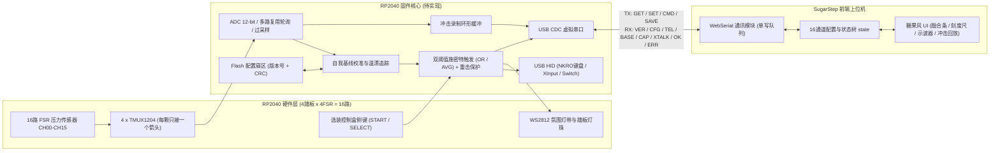
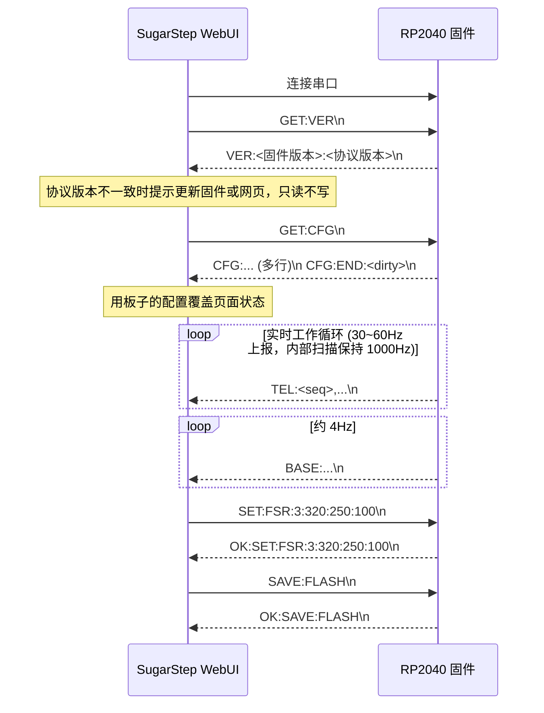

# SugarStep · RP2040 DDR 踏板控制器设计文档与扩展开发规范

> 本文档面向两部分工作：**（1）RP2040 主控固件开发与协议对接**；**（2）前端 UI 风格、交互组件及后续新增功能的统一开发规范**。  
> 仓库：[kirisamesusi/step-lattice](https://github.com/kirisamesusi/step-lattice)（上位机前端与固件开发规范）

> **2026-11-17 修订（v4 规范）**：本版按评审结论改为"固件为准、前端只算好再下发"的分工，新增重击保护、冲击录制、版本握手、遥测帧和 Flash 配置存储，去掉 JSON 导入导出。**前端代码尚未按本版修改**，差异逐条列在文末[附录 A](#附录-a当前代码与本规范的差异待改清单)。

---

## 0. 项目概览与文件结构

SugarStep 是一款面向 DIY RP2040 DDR 跳舞机踏板控制器的可视化配置台，采用零构建依赖的纯原生 HTML / CSS / ES6+ 实现，通过浏览器 WebSerial API 与 RP2040 的 USB 虚拟串口直接通信。

| 文件 | 核心职责 | 说明 |
| :--- | :--- | :--- |
| [index.html](./index.html) | 页面骨架与视图结构 | 含顶栏、十字踏板舞台、4 个功能分区、二次确认弹窗及可整段剥离的 `devSimCard` 区块 |
| [styles.css](./styles.css) | 糖果风视觉系统与组件样式 | 含柔和三色渐变背景、果冻立体卡片、100% 等宽融合滑动条、刻度尺及 `.sim-only` 控制规则 |
| [app.js](./app.js) | 状态管理、交互逻辑与串口协议 | 含 16 路 FSR 状态模型、10 单位刻度吸附、3 位数校验、60fps 波形绘制、WebSerial |
| [DESIGN_SPEC.md](./DESIGN_SPEC.md) | 系统设计文档与开发规范 | 本文档（与代码库同步维护） |

### 0.1 分工原则

1. **板子 Flash 里的配置是唯一的真实来源。** 前端连上后先读板子的配置，再在此基础上修改；浏览器 `localStorage` 只给"未连接时的模拟预览"使用。
2. **判键只在固件里做。** 固件以 1000 Hz 扫描并判定触发；前端连机时只显示固件上报的净值、峰值和触发状态，不自己再跑一遍判键或温漂追踪。
3. **前端算好，固件只存不算。** 预设、整板统一调、内侧增敏这类"一次改多颗"的便捷功能全部由前端换算成每颗传感器的最终数值，统一用 `SET:FSR` 逐颗下发。固件不需要知道预设名或倍率。

### 系统总体架构

---

# 第一部分：RP2040 固件开发对接规范

编写 RP2040 固件时，所有传感器编号、压感换算、基线追踪与触发状态机应严格与本节保持一致，以确保网页调参手感与主控实际判键完全同步。

---

## 1. 硬件通道拓扑与传感器映射（`CH00 ~ CH15`）

控制器固定包含 `4` 块主踏板，每块踏板按 `n -> s -> w -> e` 布置 `4` 颗独立 FSR 传感器，共 `16` 路通道。方向一律按**玩家站在台上、面朝屏幕**来说：`n` 是朝屏幕的一边（↑ 方向），`s` 是朝玩家身后的一边，`w` 是玩家左手边，`e` 是玩家右手边。索引顺序严格如下：

| 踏板键名 | 踏板名称 | 固件踏板序号 `padIdx` | 内侧方向 `innerDir` | 通道映射（`CH` 编号 = `padIdx * 4 + dirIdx`） |
| :--- | :--- | :---: | :---: | :--- |
| `left` | 左踏板（←） | `0` | `e`（靠中心右侧边） | `CH00`: `n`，`CH01`: `s`，`CH02`: `w`，`CH03`: `e`（内侧） |
| `down` | 下踏板（↓） | `1` | `n`（靠中心上侧边） | `CH04`: `n`（内侧），`CH05`: `s`，`CH06`: `w`，`CH07`: `e` |
| `up` | 上踏板（↑） | `2` | `s`（靠中心下侧边） | `CH08`: `n`，`CH09`: `s`（内侧），`CH10`: `w`，`CH11`: `e` |
| `right` | 右踏板（→） | `3` | `w`（靠中心左侧边） | `CH12`: `n`，`CH13`: `s`，`CH14`: `w`（内侧），`CH15`: `e` |

> **选装外接按键说明**：`START`（确认键）与 `SELECT`（返回键）为控制盒侧面选装实体微动开关，不占用 16 路 FSR 通道，仅作普通 GPIO 消抖扫描后映射到 USB HID。

### 1.1 硬件引脚对应表

主控为 RP2040-Zero，4 颗 TMUX1204（4 选 1）各只接一个箭头的 4 颗 FSR，坏了能直接定位到是哪个箭头。4 颗共用两根选通线，选通一次就能同时拿到 4 个箭头的同一方向，依次读 4 个 ADC 脚。

| 项目 | 引脚 | 说明 |
| :--- | :--- | :--- |
| ADC0 / GP26 | 上箭头（`padIdx 2`），硬件文档中的"前" | |
| ADC1 / GP27 | 左箭头（`padIdx 0`） | |
| ADC2 / GP28 | 右箭头（`padIdx 3`） | |
| ADC3 / GP29 | 下箭头（`padIdx 1`），硬件文档中的"后" | |
| 选通 A0 / A1 | 待定（两个空闲 GPIO，4 颗共用） | 固件常量定义 |
| TMUX1204 EN | 按数据手册接到常开使能电平 | 不需要动态切换 |
| 板载 WS2812 | GP16 | RP2040-Zero 自带，规划引脚时避开，可作状态灯 |
| 灯带数据 | 待定 | 需经电平转换，见 1.2 |

> **注**：[DESIGN.md](./DESIGN.md) 按台体坐标写成"前、左、右、后"，本规范按箭头写成"左、下、上、右"。两者对应关系为：前 = ↑ 上，后 = ↓ 下（2026-11-17 确认）。ADC 脚顺序与 `padIdx` 顺序不同，由固件常量表换算。多路器的 S1–S4 接哪个方向同样写在这张常量表里，建议 S1=`n`、S2=`s`、S3=`w`、S4=`e`。接线以后若有出入，只改常量表，不改线。

### 1.2 电路要求

1. **滤波电容放在多路器前面。** 每颗 FSR 的分压点各接一个小电容（初值 10 nF）到地，再进多路器。**不要**在多路器之后、ADC 脚一侧放电容，否则电容会留住上一路的电压，读下一路时带过来，形成通道间串扰。
2. **分压与 ADC 同源供电。** RP2040 的 ADC 以 3.3 V 为基准，FSR 分压也从同一个 3.3 V 取电，电源波动时读数与基准同比变化、互相抵消。接法为 FSR 接 3.3 V，下拉电阻接地，中点进多路器，压力越大读数越高。下拉电阻初值按 4.7 k–10 k 试，看真实触发力落在量程哪一段再定。
3. **灯带与传感分开。** 踩下时灯一闪，电流突变会让地线电位跳动，其他格读数被抬起，现象与机械共振相同。要求：LED 的 5 V 与地单独走线回电源；FSR 信号线不与灯的数据线、电源线并行捆扎；固件限制灯带总亮度，USB 供电一般只保证 500 mA，超出时必须限流或独立供电。WS2812 用 5 V，RP2040 输出 3.3 V 信号，数据线加电平转换（如 74AHCT125）。
4. **金属框架单点接地。** 2020 铝架与钢板选一个点接到控制板地；USB 口加 ESD 保护。

### 1.3 采样时序

1. 设置选通线后先空读一次并丢弃，再取数；在 4 个 ADC 脚之间切换时同样丢弃首个读数。
2. 每路连续读 8–16 次取平均（过采样）。完整扫描 16 路的时间不超过 1 ms。
3. RP2040 ADC 在若干固定码值（如 512、1536、2560、3584，12 位）附近有已知的非线性跳变（RP2040 勘误 E11）。过采样后基本感觉不到，阈值避免正好落在这些值上。
4. 双核分工：核 0 只做采样、判键和 USB HID 上报；核 1 跑灯效、串口遥测和冲击录制数据上传。灯效和网页再忙也不拖慢判键。

---

## 2. 压感换算、校准与触发算法规范

### 2.1 数值坐标系与量程约定

| 参数 | 量程范围 | 数据类型 | 说明 |
| :--- | :---: | :---: | :--- |
| 原始 ADC 读数 `raw[i]` | `0 ~ 4095` | `uint16_t` | RP2040 原生 12-bit，**不右移**，过采样后的均值。轻踩那一段需要这点精度 |
| 空载基线 `baseline[i]` | `0 ~ 2000` | `float` | 与 `raw` 同单位。手动校准时限制在此范围内，防止误把重压锁成基线 |
| 信号增益 `gain[i]` | `50 ~ 150`（%） | `uint8_t` | 传感器独立放大倍率，默认 `100` |
| 净压力值 `net[i]` | `0 ~ 999` | `uint16_t` | 与前端融合条、3 位数输入框、刻度尺统一对齐的标准 3 位数标尺 |
| 触发阈值 `trigger[i]` | `1 ~ 999` | `uint16_t` | `net` 单位。踩下判定阈值（默认 `360`），拖动滑块步进为 `10`，精确输入支持任意 3 位整数 |
| 释放回差 `release[i]` | `0 ~ maxRel` | `uint16_t` | `net` 单位。抬脚释放阈值（默认 `280`），约束规则见 2.4 节 |

以下凡写"偏差""门槛"的数值，除非注明，均为 `net` 单位（0–999）。

### 2.2 净压力换算公式

对每颗传感器 $i \in [0, 15]$，实时净压力 $\text{net}_i$ 计算如下（`raw` 与 `baseline` 为 12 位单位，乘 `999/4095` 换到 3 位数标尺）：

$$
\text{net}_i = \operatorname{clamp}\!\left(\operatorname{round}\!\left((\text{raw}_i - \text{baseline}_i) \times \frac{\text{gain}_i}{100} \times \frac{999}{4095}\right),\ 0,\ 999\right)
$$

### 2.3 自我基线校准算法（Self-Baseline Calibration）

固件实现以下三种协同校准机制：

1. **通电自动归零（`bootAutoCal = true`）**：上电等待电源稳定（建议 100–200 ms），对 16 路连续采样取均值，限幅到 `[0, 2000]` 后写入 `baseline[i]`。使用说明中告知玩家：首次上电时不要站在台上。
2. **指令触发瞬时校准（`CMD:CAL_BASE:*`）**：收到全部、单踏板或单通道校准命令后，采样当前空载短窗口均值更新对应 `baseline[i]`，并限幅 `[0, 2000]`。
3. **动态温漂追踪（`autoDriftTrack = true`）**：按下列条件和速率缓慢吸收温漂及踏板弹性件的形变回弹。
   - **何时追踪**：该传感器所在的**整块踏板**未触发，且距该踏板上次释放已超过 `500 ms`，且 $|\text{raw}_i - \text{baseline}_i|$ 换算到 `net` 单位小于 `25`。只看单颗是否触发不够：脚踩在同一块板另一边时，这一颗只受一点力、不过线，基线会被一点点抬高，整块板逐渐变钝。
   - **追踪速度按时间常数定义**，与采样频率无关。每次更新 $\text{baseline}_i \leftarrow \text{baseline}_i + \frac{\Delta t}{\tau} (\text{raw}_i - \text{baseline}_i)$，$\Delta t$ 为两次更新的间隔。
   - **下快上慢**：读数低于基线时 $\tau_\downarrow = 0.5\ \text{s}$；读数高于基线时 $\tau_\uparrow = 5\ \text{s}$。基线偏高会让板子变钝，比偏低更糟，所以往下跟得快。两个值为初值，样件实测后调整。

> **与机械结构的关系**：当前结构在箭头板与压头之间留有空载间隙，FSR 空载时接近开路，读数接近 0，基线影响不大。若改为回位件预压，FSR 空载时持续受力，基线和温漂追踪就会变得重要，届时按实测重定 2.3 的参数。

### 2.4 双阈值施密特触发与踏板合成

1. **回差约束规则**：始终保证释放线严格低于触发线，防止零点附近高频连击抖动：

$$
\text{maxRel}_i = \begin{cases} \text{trigger}_i - 20, & \text{trigger}_i > 20 \\ \max(0,\ \text{trigger}_i - 1), & \text{trigger}_i \le 20 \end{cases}
$$

2. **单传感器状态转移**：
   - 未触发态（`active == false`）：当 `net` 连续 `debounceMs`（默认 `2.0 ms`）都不低于有效触发线（见 2.5 重击保护）时，置为 `active = true`；
   - 已触发态（`active == true`）：当 `net <= release` 时，置为 `active = false`。
3. **踏板合成逻辑（`padLogic`）**：
   - **`OR` 模式（默认，任一传感器过线即触发）**：4 颗传感器中任意 1 颗 `active == true`，则该踏板判定按下；4 颗均 `false` 时释放。适合踩边缘/脚跟蹭键。
   - **`AVG` 模式（四颗平均值过线触发）**：计算 4 颗净压力均值 `avgNet`、平均触发线 `avgTrig` 与平均释放线 `avgRel`；未触发时 `avgNet >= avgTrig` 触发，已触发时 `avgNet <= avgRel` 释放。适合防止单角误重压或做整板平均力称重触发。
4. **内侧边增敏（`innerBoost`，前端功能）**：
   - 只改触发线一项：开启时前端把 `left.e (CH03)`、`down.n (CH04)`、`up.s (CH09)`、`right.w (CH14)` 当前的 `trigger` 与 `release` 各乘 `0.85`，**增益不变**，再按 `SET:FSR` 逐颗下发。不得同时降触发线又提增益，两者叠加实际约为 1.35 倍。
   - 开启前，前端保存这 4 颗原来的 `trigger / release`；关闭时恢复保存的值，而不是改成对侧的值或改回某个固定增益，避免冲掉单独调过的数值和预设里的增益。
   - 固件不需要知道增敏开关的存在。
5. **长按（freeze arrow）与 FSR 蠕变**：FSR 在持续受力时读数会缓慢下滑。释放线与触发线要拉开足够距离，默认 `360 / 280` 需用 5–10 秒长按实测，确认长押过程中不会自己释放。

### 2.5 重击保护（防邻格串扰）

重踩一格时，台体震动、灯带电流突变都可能让其他箭头短暂出现读数。固件在检测到重击后，临时抬高**其他 3 块踏板**的触发线，抬高量随时间线性回落。

| 参数 | 默认值 | 范围 | 说明 |
| :--- | :---: | :---: | :--- |
| `guardLevel` | `700` | `100 ~ 999` | 某块踏板的 `maxNet` 由低于此值升过此值时，视为一次重击 |
| `guardRaise` | `120` | `0 ~ 500` | 重击瞬间其他踏板触发线的抬高量，`0` 表示关闭重击保护 |
| `guardMs` | `25` | `0 ~ 100` | 抬高量从 `guardRaise` 线性回落到 `0` 所用的时间 |

规则：

1. 有效触发线 = `trigger + 当前抬高量`。**只抬高，不屏蔽**：真正的双押或紧接着踩别的箭头，力量足够仍能触发。
2. 被重击的那块踏板自身不受影响；已经处于触发态的传感器不受影响；释放线不变。
3. 多块踏板先后重击时，各自产生的抬高量取最大值，不累加。
4. 默认值只是起点，推荐用下面的串扰校准自动算出。

**串扰校准流程**（在"高级与校准"页发起）：

1. 前端发送 `CMD:XTALK_CAL:START`，提示玩家在 20 秒内把每块踏板各重踩 3 次以上。
2. 固件每次检测到重击（按 `guardLevel`），记录随后 `100 ms` 内其他 3 块踏板各自的最大 `net`，以及读数回落到 `25` 以下所用的时间，上报 `XTALK:HIT` 帧。
3. 时间到或收到 `CMD:XTALK_CAL:STOP` 后，固件上报建议值：`guardRaise` = 所有记录中最大串扰值 × `1.5`（上限 `500`），`guardMs` = 最长回落时间 + `10 ms`（上限 `100`）。
4. 前端展示每块踏板的串扰数据和建议值，玩家确认后由前端发送 `SET:GUARD`。固件不自动套用。

### 2.6 冲击录制

用于沙袋落袋测试和排查误触。固件持续把 16 路 `net` 以 1000 Hz 写入环形缓冲区。

1. 前端发送 `CMD:CAP:ARM:<level>:<preMs>:<postMs>`（默认 `700:50:150`）使录制待命。
2. 任一踏板 `maxNet` 升过 `level` 时触发，固件保留触发前 `preMs` 和触发后 `postMs` 的数据（默认共 200 条 × 16 路，约 6.4 KB）。
3. 触发后固件暂停 `TEL` 遥测，用 `CAP` 帧整段上传，上传完恢复遥测。每次待命只录一次，再录需重新 `ARM`。
4. 前端画出 16 路曲线，标出触发时刻和哪块踏板被踩，并可导出 CSV（列：毫秒, CH00…CH15）。

---

## 3. WebSerial 串口通讯协议规范

- **物理接口**：RP2040 USB CDC 虚拟串口。前端打开串口时填 `115200`，但 USB 虚拟串口实际不看波特率，传输速度与此无关。
- **帧格式**：纯 ASCII 文本行，每条指令/上报以 `\n`（兼容 `\r\n`）结尾。
- **协议版本**：本规范为协议版本 `4`。

### 3.1 握手与遥测时序

### 3.2 上行数据帧（RP2040 -> WebUI）

| 帧格式 | 说明 | 前端处理 |
| :--- | :--- | :--- |
| `VER:<fw>:<proto>` | 固件版本字符串（如 `1.0.0`）与协议版本整数 | 协议版本不一致时提示，并禁止下发 `SET` / `SAVE` |
| `CFG:<KEY>:<ARGS>` | 配置回读，每项一行，`KEY` 与 3.3 节 `SET` 指令同名、参数同序，如 `CFG:FSR:3:320:250:100`、`CFG:GUARD:700:120:25` | 逐行写入页面状态 |
| `CFG:END:<dirty>` | 配置回读结束；`dirty` 为 `1` 表示板子内存里有未写入 Flash 的改动 | 刷新全部界面，按 `dirty` 设置"未保存"提示 |
| `TEL:<seq>,<padMask>,<sensorMask>,<net0>..<net15>,<peak0>..<peak15>` | 实时遥测。`seq` 为 0–65535 循环计数；`padMask` 为 1 位十六进制（bit0–3 对应 `padIdx` 0–3 的触发态）；`sensorMask` 为 4 位十六进制（bit0–15 对应 CH00–CH15 的触发态）；`net` 为当前净值；`peak` 为上一帧以来该路的最大净值 | 驱动压感条、踏板触发显示和示波器；`seq` 不连续时计数丢帧；**不打印到串口日志** |
| `BASE:<raw0>..<raw15>,<base0>..<base15>` | 低频状态，约 4 Hz。12 位单位的原始读数均值和当前基线 | 更新高级页"原 / 基"显示 |
| `XTALK:HIT:<padIdx>:<x0>:<x1>:<x2>:<x3>:<ms>` | 串扰校准中的一次重击。`x0–x3` 为 4 块踏板在随后 100 ms 内的最大 `net`（被踩那块填 `-`）；`ms` 为回落时间 | 累计显示 |
| `XTALK:RESULT:<raise>:<ms>` | 串扰校准结束，给出建议的 `guardRaise` 与 `guardMs` | 展示，等待玩家确认 |
| `CAP:BEGIN:<id>:<padIdx>:<count>:<pre>` | 冲击录制开始上传。`padIdx` 为触发的踏板，`count` 为总条数，`pre` 为触发前条数 | 准备接收 |
| `CAP:<n>,<net0>..<net15>` | 第 `n` 条录制数据（每条间隔 1 ms） | 缓存 |
| `CAP:END:<id>` | 上传结束 | 检查条数，绘图，开放导出 CSV |
| `OK:<原指令>` | 指令执行成功 | 记录日志；`OK:SAVE:FLASH` 后清除"未保存" |
| `ERR:<code>:<原指令>` | 指令失败。`code` 取 `UNKNOWN`（未知指令）、`BAD_ARG`（参数越界或格式错）、`BUSY`（校准或录制上传中）、`FLASH`（写 Flash 失败）、`PROTO`（协议版本不符） | 记录日志并 Toast 提示 |
| 其它任意文本行 | 固件调试日志 | 加时间戳与 `[RX]` 标签输出到串口调试终端 |

> 旧的 `FSR16:` 帧（16 路原始读数）在协议 4 中废弃。前端可保留解析以兼容早期测试固件，但连机显示以 `TEL` 为准。

### 3.3 下行控制指令表（WebUI -> RP2040）

| 指令格式 | 参数范围与含义 | 触发时机 |
| :--- | :--- | :--- |
| `GET:VER` | 无参数 | 串口建立连接后第一条 |
| `GET:CFG` | 无参数 | 版本校验通过后 |
| `SET:FSR:<ch>:<trig>:<rel>:<gain>` | `ch`: `0~15`，`trig`: `1~999`，`rel`: `0~maxRel`，`gain`: `50~150` | 所有改动单颗或多颗阈值/增益的操作，包括预设、整板统一调、内侧增敏（前端换算后逐颗发送） |
| `SET:PAD_LOGIC:<OR\|AVG>` | `OR`=任一过线触发，`AVG`=四颗均值过线 | 切换「踏板触发规则」下拉框时 |
| `SET:DRIFT_TRACK:<0\|1>` | 开关动态温漂追踪 | 切换高级页复选框时 |
| `SET:BOOT_CAL:<0\|1>` | 开关通电自动归零 | 切换高级页复选框时 |
| `SET:DEBOUNCE:<x10>` | 去抖时间，整数 `5~100`，单位 0.1 ms | 拖动去抖滑块时 |
| `SET:GUARD:<level>:<raise>:<ms>` | 见 2.5 节参数表 | 修改重击保护参数，或确认串扰校准建议值时 |
| `SET:LED_MODE:<MODE>` | `RIPPLE` / `RAINBOW` / `BREATHE` / `AFTERGLOW` / `SOLID` | 点击灯效模式卡片时 |
| `SET:LED_COLOR:<padIdx>:<RRGGBB>` | 4 块踏板 RGB 十六进制颜色 | 修改颜色或配色方案时 |
| `SET:LED_PARAM:<bright>:<idle>:<speed>` | 触发亮度 `10~100`、待机底光 `0~80`、速度 `10~100`。固件另按总电流上限压低实际亮度 | 拖动灯光滑块时 |
| `SET:KEYMAP:<slot>:<hidCode>` | `slot`: `left/down/up/right/start/select`；`hidCode` 为 USB HID Usage ID | 修改按键映射时 |
| `SET:HID:<MODE>` | `KEYBOARD` / `XINPUT` / `SWITCH`。**需要写入 Flash 并重新枚举 USB**，见 3.5 | 切换 HID 输出模式时 |
| `SET:POLL:<HZ>` | `1000` / `500` / `250`。**需要重新枚举 USB**，见 3.5 | 切换 USB 回报率下拉框时 |
| `CMD:CAL_BASE:ALL` | 无参数 | 点击「校准全部 16 颗基线」时 |
| `CMD:CAL_BASE:PAD:<padIdx>` | `padIdx`: `0~3` | 点击「校准当前踏板 (4颗)」时 |
| `CMD:CAL_BASE:CH:<ch>` | `ch`: `0~15` | 点击单颗传感器卡片「校准基线」时 |
| `CMD:XTALK_CAL:START` / `CMD:XTALK_CAL:STOP` | 见 2.5 节 | 串扰校准开始 / 提前结束 |
| `CMD:CAP:ARM:<level>:<preMs>:<postMs>` / `CMD:CAP:DISARM` | 见 2.6 节 | 冲击录制待命 / 取消 |
| `CMD:RESET_DEFAULTS` | 无参数，恢复内存中的出厂默认值，不自动写 Flash | 用户在二次确认弹窗点击「确定恢复」后 |
| `SAVE:FLASH` | 无参数 | 点击顶部「保存设置」按钮时 |
| `CMD:BOOTSEL` | 无参数，调用 `reset_usb_boot(0, 0)` 进入 UF2 烧录盘 | 点击高级页「进入刷机模式」时 |

协议 4 删除的指令：`SET:PAD_TRIG`、`SET:PROFILE`、`SET:INNER_BOOST`。对应功能由前端换算后用 `SET:FSR` 实现。

### 3.4 前端发送规则

1. **单写队列**：整个连接期间只取一次 `writable.getWriter()` 并一直持有，所有指令进同一个队列依次写出。不得每条指令各自 `getWriter()`：前一条未写完时后一条会抛错，错误被吞掉，指令就静默丢失。
2. **拖动限频**：拖动滑块时，同一项设置最多每 `30 ms` 发一条；松手（`change` 事件）时补发最终值。
3. **断开处理**：监听 `navigator.serial` 的 `disconnect` 事件处理 USB 拔出。主动断开时先 `reader.cancel()`，等读取管道结束后再 `port.close()`，避免端口关不干净导致重连失败。断开后界面回到未连接状态。

### 3.5 USB 模式切换与设置模式

1. 切换 `SET:HID` 或 `SET:POLL` 时，固件先回 `OK`，写入 Flash，再断开 USB 重新枚举（相当于重启）。前端提示"控制器将重新连接"，并在设备重新出现后提示用户重新连接。
2. 在 `XINPUT` 和 `SWITCH` 模式下，USB 虚拟串口很可能无法同时工作，网页连不上属于正常现象。
3. **设置模式**：插入 USB 时同时踩住 ← 和 →（或按住选装的 `SELECT`），固件本次以"键盘 + 串口"模式启动，不改 Flash 里保存的 HID 模式。保证任何模式下都有办法回到网页设置。界面上切换到 XInput / Switch 前要提示这个方法。

---

## 4. 出厂默认参数与配置存储

### 4.1 出厂默认值总表

- **灵敏度预设（`PROFILES`，仅前端使用，固件只收到换算后的逐颗数值）**：
  - `cotton`（轻触）：触发 `210`，释放 `155`，增益 `105%`
  - `arcade`（标准，**默认**）：触发 `360`，释放 `280`，增益 `100%`
  - `pudding`（防误触）：触发 `540`，释放 `430`，增益 `95%`
- **校准设置**：`autoDriftTrack = true`，`bootAutoCal = true`，`padLogic = 'or'`，`innerBoost = false`；温漂 $\tau_\downarrow = 0.5\ \text{s}$、$\tau_\uparrow = 5\ \text{s}$、追踪门槛 `25`、释放后等待 `500 ms`
- **重击保护**：`guardLevel = 700`，`guardRaise = 120`，`guardMs = 25`
- **灯效设置（经典糖果配色 `classic`）**：`effect = 'ripple'`，`brightness = 85%`，`idleBrightness = 28%`，`speed = 60%`
  - 左 `#FF6B9E` / 下 `#4CC9F0` / 上 `#42E2A4` / 右 `#FFB703`
- **按键与性能**：`hidMode = 'keyboard'`，`pollingHz = 1000`，`debounceMs = 2.0`
  - 默认键位：`left = 'ArrowLeft'`、`down = 'ArrowDown'`、`up = 'ArrowUp'`、`right = 'ArrowRight'`、`start = 'Enter'`、`select = 'Shift'`

### 4.2 Flash 配置存储

配置保存在 Flash 的**最后一个 4 KB 扇区**，链接脚本保证程序不占用这个扇区。刷新 UF2 固件只改写程序区，配置不受影响，因此不需要 JSON 导入导出做备份。

| 字段 | 说明 |
| :--- | :--- |
| `magic` | 固定标识，如 `0x53535445`（"SSTE"） |
| `version` | 配置结构版本号，结构有改动就加一 |
| `length` | 配置数据长度 |
| 配置数据 | 16 路 `trigger / release / gain / baseline`、`padLogic`、温漂与上电校准开关、重击保护、去抖、灯效、键位、HID 模式、回报率 |
| `crc32` | 以上全部内容的校验 |

1. 只在收到 `SAVE:FLASH` 时写入，其余 `SET` 只改内存。
2. 上电读取：`magic` 或 `crc32` 不对就用出厂默认值；`version` 比当前固件旧就按字段逐项迁移，缺的项用默认值补齐。
3. `bootAutoCal` 开启时，上电得到的基线覆盖 Flash 里存的基线；关闭时使用 Flash 里的基线。
4. 浏览器 `localStorage` 只保存未连接时的模拟预览设置，连机后以板子为准。

---

## 5. 「无固件模拟测试」交付剥离规范

网页内部的所有开发调试测试能力（鼠标按住踏板预览、键盘 DFJK / 方向键测试、首页「按住试踩」、高级页「按住试压」、底噪抖动以及离线 `OK:` 串口伪回包）全部与 `state.simTest.enabled` 绑定：

1. **临时切换纯净界面**：在「高级与校准」底部取消勾选 `#chkSimMode`（`开启模拟测试`）：
   - `body` 移除 `.sim-enabled` 类，所有带 `.sim-only` 类的网页试踩按钮通过 `body:not(.sim-enabled) .sim-only { display: none !important; }` 自动隐藏；
   - 顶栏连接胶囊切换为「未连接 · 点击连接」，点击踏板舞台仅作选中切换，不产生虚拟受力，波形安静回归零位；
   - 只要连接真实硬件串口（`state.serial.connected === true`），即使模拟开关处于开启态也会自动让位于真实 `TEL:` 数据。
2. **正式交付彻底移除**：固件全部调试完成后，直接删除 [index.html](./index.html) 中 `<!-- [SIM-TEST-START] -->` 到 `<!-- [SIM-TEST-END] -->` 之间的整个 `#devSimCard` 代码块即可。[app.js](./app.js) 内部均已做空值判断（`Boolean(devSimCard && enabled)`），删去后自动以零报错的纯净硬件上位机形态运行。

---

# 第二部分：前端 UI 详细设计与后续功能扩展规范

后续在界面中增加任何新开关、新滑块、新卡片或新分页时，必须严格遵守以下视觉、交互与代码组织规范，确保整体风格不割裂、体验保持统一。

---

## 6. 视觉设计系统规范（Candy Design System）

### 6.1 色彩与字体 Token

已在 [styles.css](./styles.css) `:root` 定义的核心样式变量：

| Token / 色值 | 数值 | 用途 |
| :--- | :--- | :--- |
| 背景渐变 | `#fff5fa -> #f4f1ff -> #eefcf7`（135deg） | 草莓奶油 -> 薰衣草紫 -> 浅薄荷全局底色 |
| `--card-bg` / `--card-border` / `--card-shadow` | `rgba(255,255,255,0.94)` / `#ffd5e8` / `#f3c1da` | 主卡片半透明糖霜白底、粉边框与 3D 底部投影 |
| `--ink-main` / `--ink-soft` / `--ink-muted` | `#4a2d4c` / `#7f6282` / `#a68ea9` | 梅子深紫主标题、柔紫正文、淡灰紫辅助说明 |
| `--pad-left` / `--pad-down` / `--pad-up` / `--pad-right` | `#ff6b9e` / `#4cc9f0` / `#42e2a4` / `#ffb703` | 左草莓粉、下气泡蓝、上薄荷绿、右布丁黄四踏板标识色 |
| 主体字体 `--font-display` / `--font-body` | `Fredoka`, `Nunito`, `PingFang SC`, `Microsoft YaHei` | 圆润无衬线字体搭配高加粗字重（`700 ~ 900`） |

### 6.2 圆角、阴影与按钮层级规范

- **大圆角体系**：顶部导航栏与主卡片 `.candy-card` 使用 `26px` 圆角 + `0 8px 0 var(--card-shadow)` 立体投影；内部小卡（`.edge-row-card` / `.adv-sensor-card` / `.fused-meter-box`）使用 `16px ~ 20px` 圆角；导航选项、预设芯片、状态徽章与按钮统一采用全圆角胶囊 `border-radius: 999px`。
- **按钮分类**：
  - 主要操作（`.primary-btn`）：草莓渐变 + `#d4376d` 立体底影（如「保存设置」、「确定恢复」、「校准全部 16 颗基线」）；
  - 次级操作（`.cream-btn`）：奶油白底 + `#ffd5e8` 描边 + `#f2c4db` 立体底影（如「恢复默认」、「取消」）；
  - 按压动效：悬浮上抬 `translateY(-2px)`，点击下沉 `translateY(2px)` 配合底影压缩。
- **字符防乱码守则**：
  - 优先使用内联 SVG 图形（如棒棒糖 Logo、中心控制器笑脸图标、方向箭头）；
  - **禁止在界面文案中引入较生僻的高位 Unicode Emoji**（如气泡、软糖等易在部分 Windows 系统字体中渲染为豆腐块 `▯` 的字符），仅允许基础符号（如 `🔊` / `🔇`、`← ↓ ↑ →`）。

---

## 7. 信息架构与核心组件交互规范

### 7.1 渐进式披露（Progressive Disclosure）分层准则

新增功能模块前，必须先按使用频次决定其界面落位：

1. **常规直觉区（默认双栏：左踏板舞台 + 右配置单卡）**：
   - 仅放普通玩家日常直接会调的内容：**踏板灵敏度**（整板/四边切换、快捷预设、内侧增敏）、**灯光效果**、**按键设置**；
   - 保持每屏一件事，严禁在首页堆叠接线图、自动铺面或 16 路裸参数框。
2. **高级与校准区（全宽多卡视图 `#view-advanced`）**：
   - 收纳硬核调参、运维与开发功能：**自我基线校准**、**分踏板 4 颗传感器独立精调**（按 `← / ↓ / ↑ / →` 分板切换，不将 16 颗全部平铺成一坨）、**重击保护与串扰校准**、**实时示波器**（显示峰值）、**冲击录制与回放**、**串口终端与固件维护**、以及调试期的 **无固件模拟测试**。
3. **选装扩展区（`.optional-keys-box`）**：
   - 如控制盒侧面实体 `START / SELECT` 等非标配功能，必须明确标注「（选装）」与「可忽略」说明，避免四键踏板用户困惑。
4. **文案精简去 AI 味原则**：
   - 标题、提示语与按钮一律用玩家看得懂的口语化短句（例如「调整踩下多用力时触发按键」、「实时踩踏力度」），禁止空泛冗长的机械式描述。

### 7.2 100% 等宽融合条与刻度尺标准

所有涉及到「压感力度 + 阈值调节」的条状控件，**严禁**将显示进度条和可拖动滑块拆成不同宽度的两条。必须遵循统一几何标准：

1. **满宽轨道等长原理**：
   - 外层显示槽 `.fused-bar-track`、双线槽 `.adv-dual-meter`、全宽滑块槽 `.full-slider-track` 与下方刻度尺 `.fused-ruler` 一律设为 `width: 100%`，左右零缩进（`.aligned-track-pad { padding: 0; }`）；
   - `<input type="range">` 统一样式为 `left: -9px; width: calc(100% + 18px);`，恰好抵消 `18px` 滑块手柄的左右各 `9px` 半径，使 `val = 0` 到 `val = 999` 的手柄中心移动行程严格重合于轨道的 `0% ~ 100%`；
   - **鼠标光标标准**：所有滑块、融合槽与滑动手柄的 `cursor` 必须为 **`default`（标准箭头）**，不使用手型或左右双向拉伸箭头。
2. **糖果果冻视觉样式**：
   - 融合控件整体包裹在奶油草莓卡槽容器 `.fused-meter-box` 内；
   - 滑槽底层带有每隔 `100` 单位（`10.01%`）的垂直参考纹路与下方刻度尺主刻度精准垂直对齐；填充条内带 `::after` 白色高光条，触发手柄带红色中心准星线。
3. **刻度尺与拖动吸附规则**：
   - `mountRuler(rulerEl, onPickVal)` 自动生成每 `10` 细刻、每 `50` 中刻与每 `100`（`0, 100, ..., 900, 999`）可点击主刻数字；
   - **双轨设定机制**：
     - 拖动/点击滑块（`{ snap: true }`）：通过 `snapTrigStep` / `snapRelStep` / `snapSimStep` 自动吸附到 **10 的整数倍**（触发 `playRulerTick()` 刻度滴答音并由 `highlightRulerTick()` 高亮当前整百数字）；
     - 3 位数数字输入框（`bindThreeDigitInput` + `{ snap: false }`）：`maxlength="3"` 仅允许纯数字，按下 **Enter** 或 **失焦（blur）** 即刻生效（按 **Esc** 放弃当前输入），支持 `1 ~ 999` 精确到个位的自定义值，**不得强制吸附取整**。
   - **禁止冗余操作提示**：输入框旁不再附带「回车设定」等多余说明文字。

### 7.3 安全操作与二次确认规范

- 所有会**批量清空或重置配置**的操作（如「恢复默认」），不得无条件直接覆盖状态：
  - 先通过 `isConfigModified()` 逐字段比对当前状态与出厂默认值；
  - 未修改时直接弹出 Toast 轻提示（如 `当前已是默认设置`），零弹窗打扰；
  - 检测到存在修改时，打开 `.confirm-modal` 糖果风格二次确认弹窗，提供明确的「取消」与主操作按钮（并支持点击遮罩和 `Esc` 键关闭）。

### 7.4 连机时的数据来源

1. 连上真机后，界面上的净值、峰值、触发状态、基线全部来自固件上报（`TEL` / `BASE`），前端不自己计算判键、不跑温漂追踪。
2. 未连接且开启模拟测试时，前端才在本地用同一套公式模拟，供离线预览。
3. 协议版本不一致时，界面只读：可以看遥测，滑块和保存按钮置灰，并提示更新固件或网页。

### 7.5 未保存提示

`SET` 指令实时生效但只改板子内存，断电即丢。只要有改动尚未 `SAVE:FLASH`，顶栏「保存设置」按钮旁就要显示「未保存」徽章；收到 `OK:SAVE:FLASH` 后清除。连接时以 `CFG:END:<dirty>` 初始化该状态。关闭或刷新页面时若仍有未保存改动，用浏览器离开确认提醒。

---

## 8. 后续新增功能 5 步标准开发清单

当需要向本控制器添加新配置项或新面板时，请按以下顺序完成接入：

1. **定义状态与默认值（[app.js](./app.js)）**：
   - 在 `state` 对象与 `resetAllDefaults()` 中同步新增字段和出厂默认值；
   - 在 `isConfigModified()` 中补充该字段与默认值的对比判定；
   - 在 `CFG:` 回读解析中接入该字段，并在固件 Flash 配置结构里加上（结构有变就把 `version` 加一并写迁移）。
2. **决定视图落位（[index.html](./index.html)）**：
   - 高频常用功能放入前 3 个常规卡片，底层硬件/维护功能放入 `#view-advanced`，临时无固件调试元素必须加上 `sim-only` 类或放在 `#devSimCard` 内；
   - 使用简明直白的一句话副标题 `.panel-hint` 说明该功能的作用。
3. **选用标准 UI 组件（[styles.css](./styles.css)）**：
   - 若涉及力度/阈值调节：直接复用 `.fused-meter-box` + `.fused-bar-track` + `mountRuler()` + `bindThreeDigitInput()`；
   - 若为普通比例滑块：使用 `.full-slider-wrap` + `.full-slider-track` + `.candy-range.full-range` 保证满宽一致，保持 `cursor: default`；
   - 若为离散开关/选项：优先使用 `.seg-switch` 分段胶囊或 `.check-pill`。
4. **绑定交互与串口指令（[app.js](./app.js)）**：
   - 在 `bindEvents()` 与对应 UI 同步函数中双向更新 DOM；
   - 若新功能需下发 RP2040，按现有规范命名指令（设置类用 `SET:<KEY>:<ARGS>`，动作类用 `CMD:<ACTION>:<ARGS>`，`CFG:` 回读与 `SET:` 同名同序），经单写队列发送（离线且开启模拟时自动模拟 `OK:` 应答）；一次改多颗的便捷功能在前端换算后逐颗下发。
5. **验收检查**：
   - 检查浏览器控制台 `0` 报错，验证在「开启模拟」和「关闭模拟 / 删除 `#devSimCard`」两种状态下均布局正常；
   - 验证「修改新功能 -> 出现未保存提示 -> 点击恢复默认触发二次确认弹窗 -> 确认后新功能归位 -> 再点恢复默认提示已是默认」全链路闭环正常；
   - 连机时验证：修改后断开重连，`CFG` 回读的值与修改一致。

---

## 附录 A：当前代码与本规范的差异（待改清单）

以下是 2026-11-17 时 [app.js](./app.js) / [index.html](./index.html) 与 v4 规范不一致的地方，改代码时逐条对照。

**协议与连接**

1. `sendSerialCommand()` 每条指令各自 `getWriter()`，并发时静默丢指令 → 改单写队列（3.4）。
2. 拖动滑块时每次 `input` 都发指令 → 限频 30 ms，松手补发（3.4）。
3. 连接后发了 `GET:CFG` 但不解析回包，页面显示的是 `localStorage` → 加 `GET:VER` 握手和 `CFG:` 解析，以板子为准（3.1、3.2）。
4. 没有处理 USB 拔出；断开时未等读取管道结束就 `port.close()` → 按 3.4 处理。
5. 只解析 `FSR16:` → 改为解析 `TEL` / `BASE` / `XTALK` / `CAP` / `OK` / `ERR`（3.2）。
6. `SET:PAD_TRIG`、`SET:PROFILE`、`SET:INNER_BOOST` → 删除，改为前端换算后逐颗 `SET:FSR`（3.3）。
7. 灯光颜色、亮度、去抖、键位尚未实时下发 → 按 3.3 接上。
8. 切换 HID 模式 / 回报率时没有重新枚举提示，也没有设置模式说明 → 按 3.5 补。

**算法与显示**

9. 连机时 `mainLoop()` 仍在本地判键和跑温漂追踪，会改写本地基线 → 连机时只显示固件上报值（7.4）。
10. 温漂追踪按单颗判断、每帧乘 `0.015` → 模拟模式也按 2.3 的新条件实现，保持与固件一致。
11. 原始读数按 10 位 `0~1023` 处理 → 改 12 位 `0~4095`，基线上限 `2000`（2.1、2.2）。
12. 内侧增敏同时乘 `0.85` 并把增益设为 `115`；关闭时把内侧改成对侧值、增益改回 `100`；`applyProfile()` 开增敏时也把内侧增益写成 `115` → 只乘 `0.85`，关闭时恢复开启前保存的值（2.4）。

**新增功能**

13. 示波器显示 `TEL` 里的峰值。
14. 高级页加「重击保护」卡片（3 个参数）和串扰校准向导（2.5）。
15. 高级页加「冲击录制」：待命、回放曲线、导出 CSV（2.6）。
16. 顶栏加「未保存」徽章和离开页面提醒（7.5）。

**删除**

17. 删除 JSON 导入 / 导出弹窗及 `exportConfigObject()` / `importConfigObject()`；`localStorage` 只留给模拟预览（4.2）。
